# HM Portal — Admin & Staff Manual

Hospitality Management event management system. This manual covers everything a staff
account can do: creating and managing events, moving them through their lifecycle,
reading reports, and managing user accounts.

Screenshots were taken from a working local installation.

---

## 1. Signing in

Open the portal and choose **Sign in**. Enter your campus email and password.

Use the password your administrator gave you. If it is a temporary password you will be
taken straight to a password screen (see [§6](#6-your-first-login-as-staff-changing-your-password)).

---

## 2. The dashboard


The staff dashboard shows:

- **Live Active Events** — events currently marked *Ongoing*.
- **Scheduled Events** — events still in *Planning*.
- **Upcoming events** — the next events on the calendar, with **View all events** and
  **Open reports** shortcuts.

The top bar has the notification bell, your initials, a light/dark mode toggle, and
**Sign out**. The navigation tabs are **Dashboard**, **Events**, and — for Admin and
Department Head accounts — **Reports**, **Users** and **Audit**.

---

## 3. Events

### 3.1 The events list

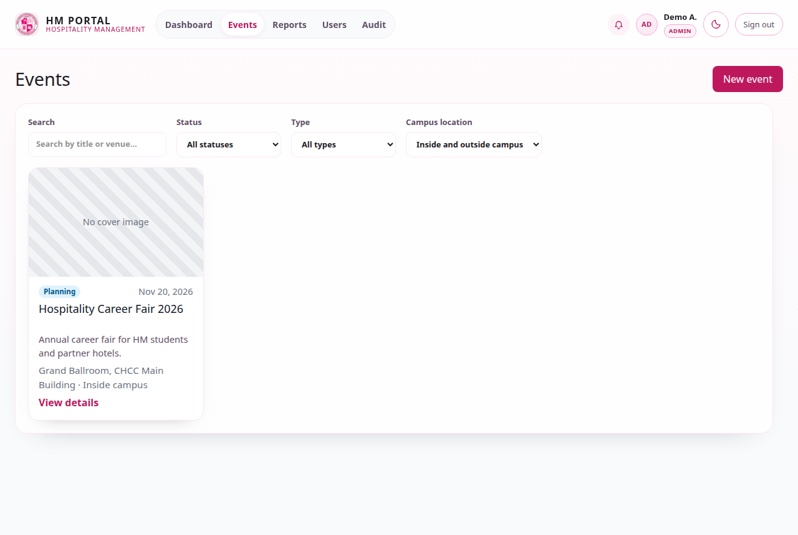

The events list is the working screen for staff. It offers:

- **Search** by title or venue.
- **Status** — All statuses, Planning, Ongoing, Completed, Cancelled.
- **Type** — All types, or a single event type.
- **Campus location** — All, Inside campus, Outside campus.

**New event** appears only for accounts that may create events: Event Coordinator,
Instructor, Student Officer, Department Head and Admin. Student accounts never see it.

### 3.2 Creating an event

Click **New event** and fill in the form.

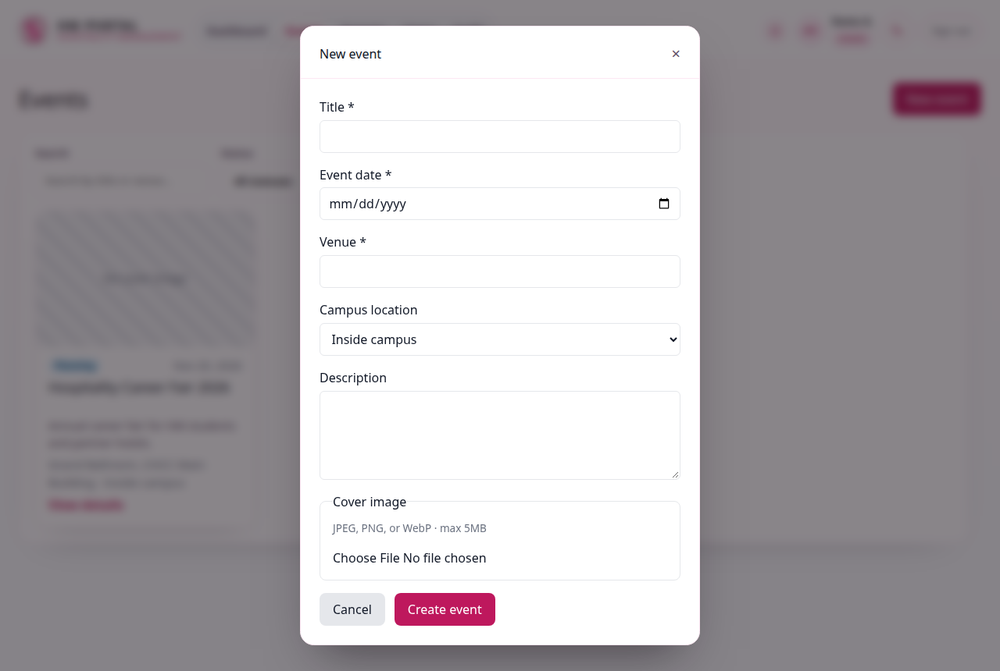

| Field | Notes |
| --- | --- |
| Title | Required. |
| Event date | Required. |
| Venue | Required — a room, building or off-campus place. |
| Campus location | *Inside campus* or *Outside campus*. |
| Description | Optional. |
| Cover image | Optional — JPEG, PNG or WebP, max 5 MB. |

Click **Create event**. The event is published immediately with the status **Planning** —
there is no approval step and nothing waits for review. You are taken to the event page.

> Events have no department field. The system covers Hospitality Management only.

### 3.3 The event page

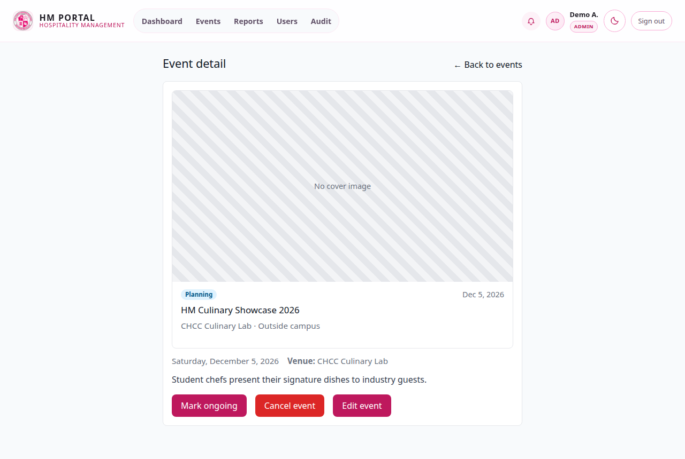

The event page is read-only. It shows the cover image, status, date, venue, campus
location and description, together with the buttons your account is allowed to use.

### 3.4 Editing an event

Click **Edit event** to open the edit window, change what you need, then **Save changes**.

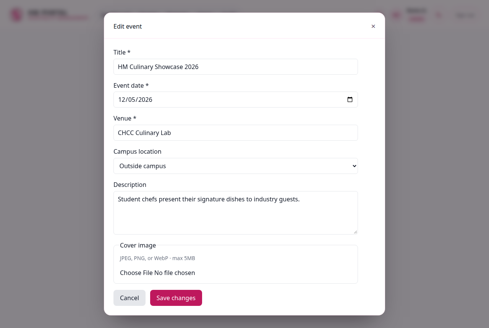

Editing is limited to the event owner, Department Head and Admin. Event Coordinators can
edit their own events and nothing else.

### 3.5 Moving an event through its lifecycle

An event moves between four statuses: **Planning → Ongoing → Completed**, plus
**Cancelled** at any point. Every change asks for confirmation and names the status it
will apply.

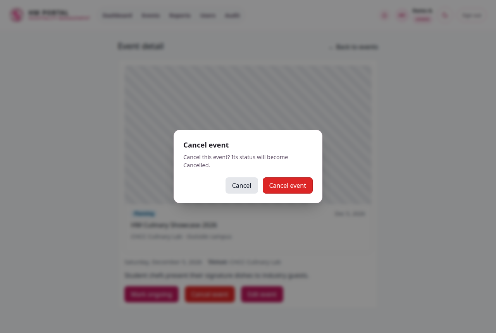

| Button | Effect | Who may use it |
| --- | --- | --- |
| **Mark ongoing** | Planning → Ongoing | Owner, Department Head, Admin |
| **Mark completed** | Ongoing → Completed | Owner, Department Head, Admin |
| **Cancel event** | Any status → Cancelled | Owner, Department Head, Admin |
| **Resume event** | Cancelled → Planning | Owner, Department Head, Admin |

A cancelled event stops appearing on the public events pages; **Resume event** puts it
back.

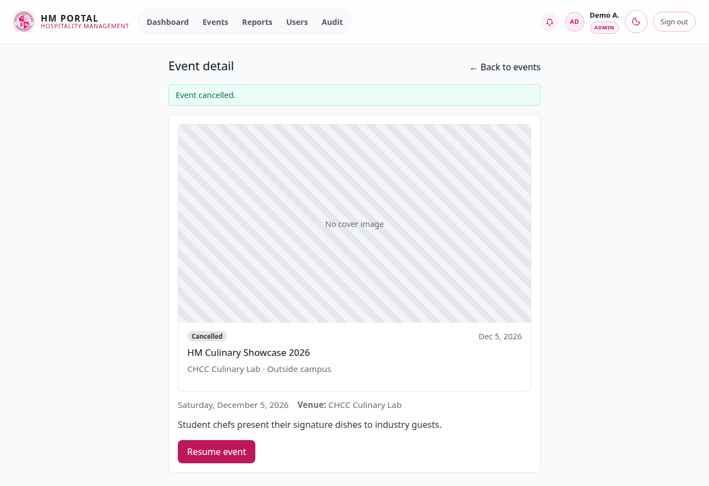

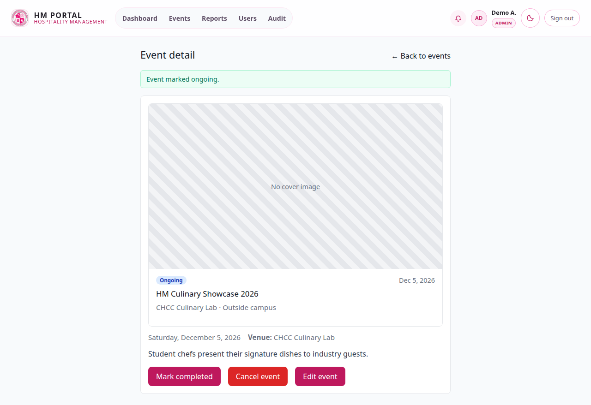

> Students can never change an event's status, no matter who created it.

---

## 4. Reports

Reports are available to **Admin** and **Department Head** accounts.

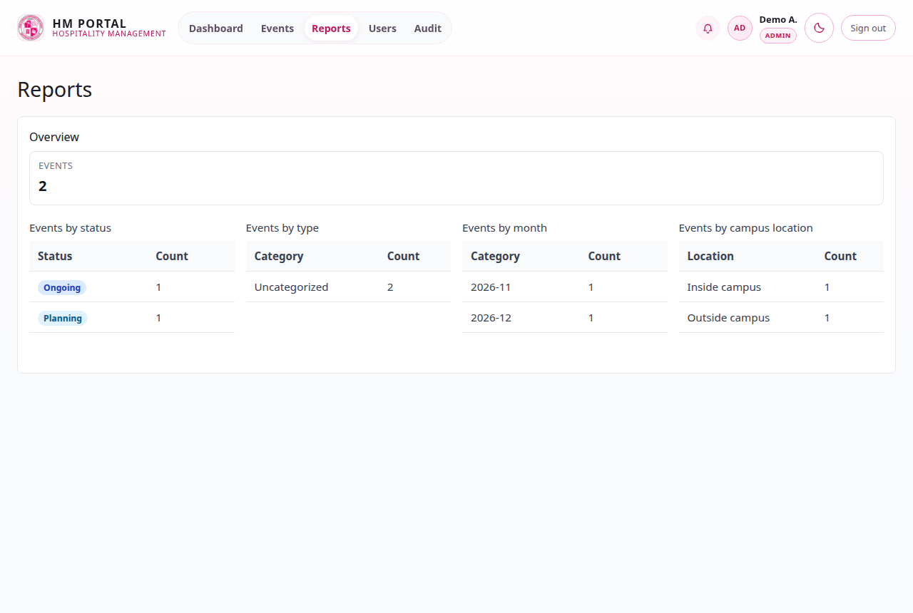

The page shows one overview figure and four tables:

- **Events by status** — how many events are Planning, Ongoing, Completed, Cancelled.
- **Events by type** — including *Uncategorised* for events with no type.
- **Events by month** — one row per `YYYY-MM`.
- **Events by campus location** — *Inside campus* and *Outside campus*.

Categories with a count of zero are still listed, so a missing number always means zero
and never "not tracked". Reports are for reading only — there are no exports.

---

## 5. Managing users (Admin only)

### 5.1 The users list

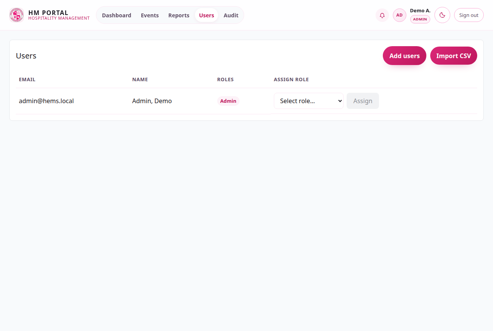

### 5.2 Adding one or more users

Click **Add users**.

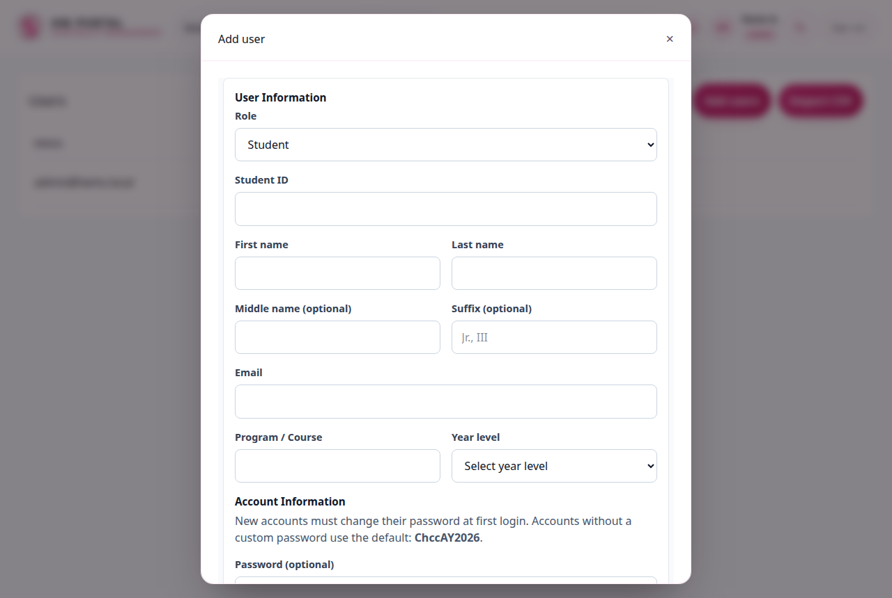

Pick the account's **role** first. Student-only fields appear only when the role is
*Student*.

| Field | Shown for | Notes |
| --- | --- | --- |
| Role | All | Department Head, Event Coordinator, Instructor, Student Officer, Student. |
| Student ID | Student only | Required for students. |
| First name | All | Required. |
| Last name | All | Required. |
| Middle name, Suffix | All | Optional. |
| Email | All | Required, must be unique. |
| Program / Course | Student only | Required for students. |
| Year level | Student only | 1–4. |

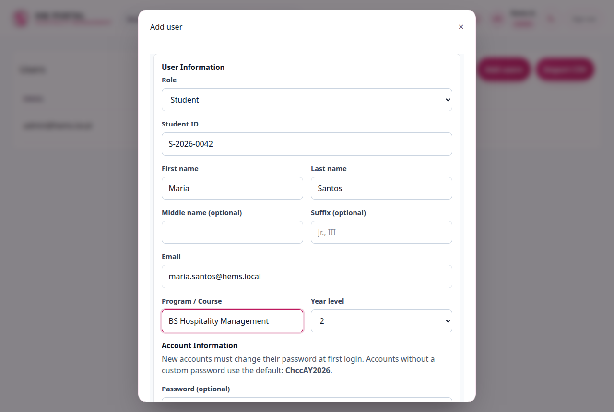

Every account created here must change its password at first login — for every role, not
just students.

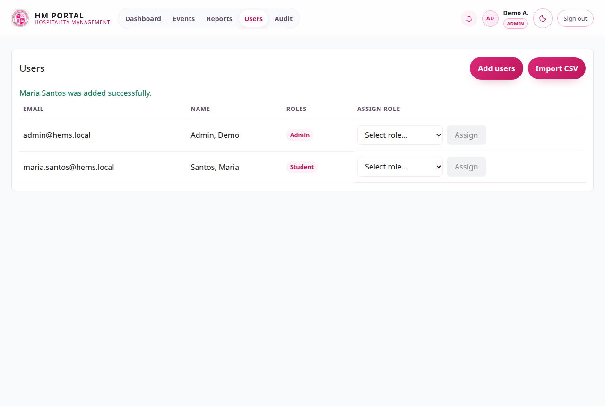

> The **Admin** role cannot be granted through the portal. It is assigned directly in the
> database, by design.

### 5.3 Importing accounts from a CSV file

Click **Import CSV** to import many accounts at once.

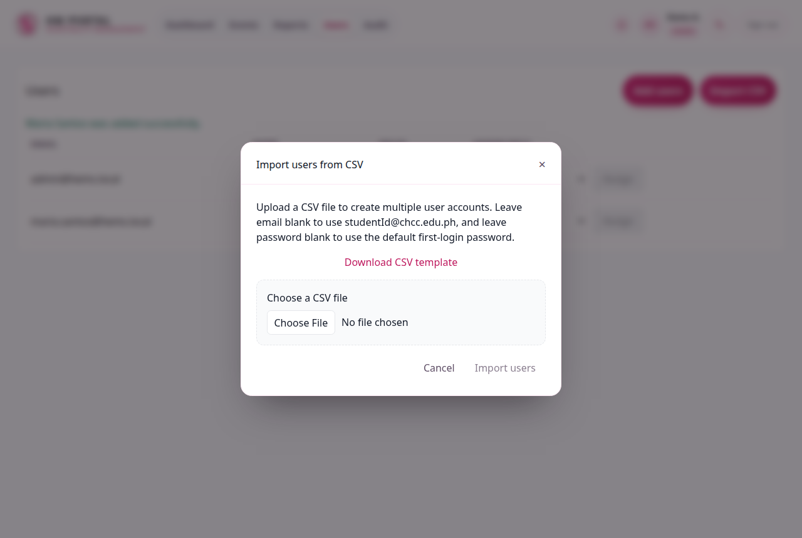

The file needs a header row. Column names are case-insensitive:

```
role,studentId,firstName,middleName,lastName,suffix,email,program,yearLevel,password,isActive
```

| Column | Required | Notes |
| --- | --- | --- |
| `role` | No | Defaults to `Student`. Values: Department Head, Event Coordinator, Instructor, Student Officer, Student. |
| `studentId` | Students only | Required for rows whose role is Student. |
| `firstName`, `lastName` | Yes | |
| `middleName`, `suffix` | No | |
| `email` | Yes | Must be unique. |
| `program`, `yearLevel` | Students only | Read but ignored for staff rows. |
| `password` | No | Blank uses the default temporary password; the account must still change it at first login. |
| `isActive` | No | Blank means active. |

Each row is reported individually — if one row fails, for example because the email is
already taken, the reason is shown for that row and the rest continue.

---

## 6. Your first login as staff: changing your password

If your account was given a temporary password, the portal sends you to
**Change your password** the first time you sign in.
Set a new password and confirm it — you cannot continue until this is done.

This applies to every role: staff, student officers, instructors and students alike.

---

## 7. Things worth knowing

- **No approval queue.** Events go live the moment they are created.
- **No attendance, no participants.** This portal manages events only.
- **Cancelled events are hidden from the public pages** until they are resumed.
- **Reports are Admin and Department Head only.**
- **The notification bell** lists notifications for your account.
- **Dark mode** uses the toggle in the top bar and is remembered on your device.
- **Lost password:** ask an Admin to reset the account; there is no self-service reset.

---

## 8. Dark mode

The moon icon in the top bar switches the whole portal to a dark theme, and your choice is
remembered on that device.

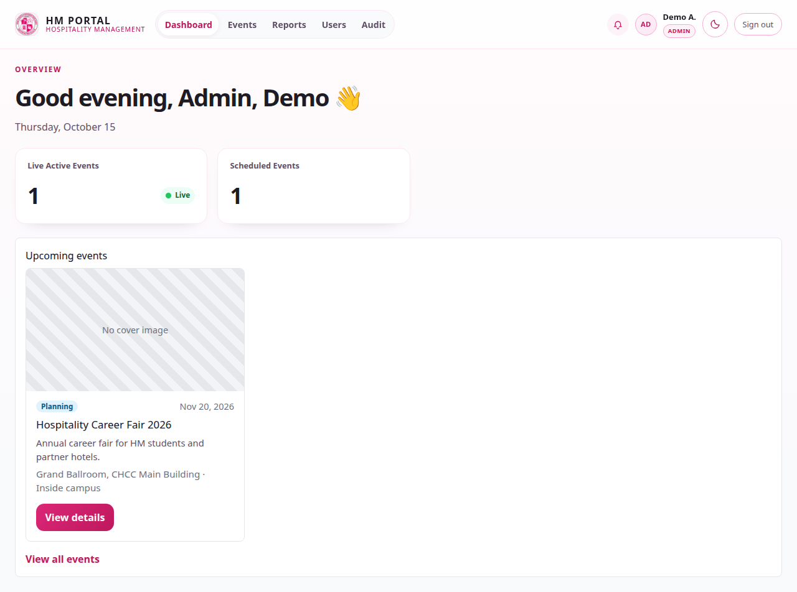
