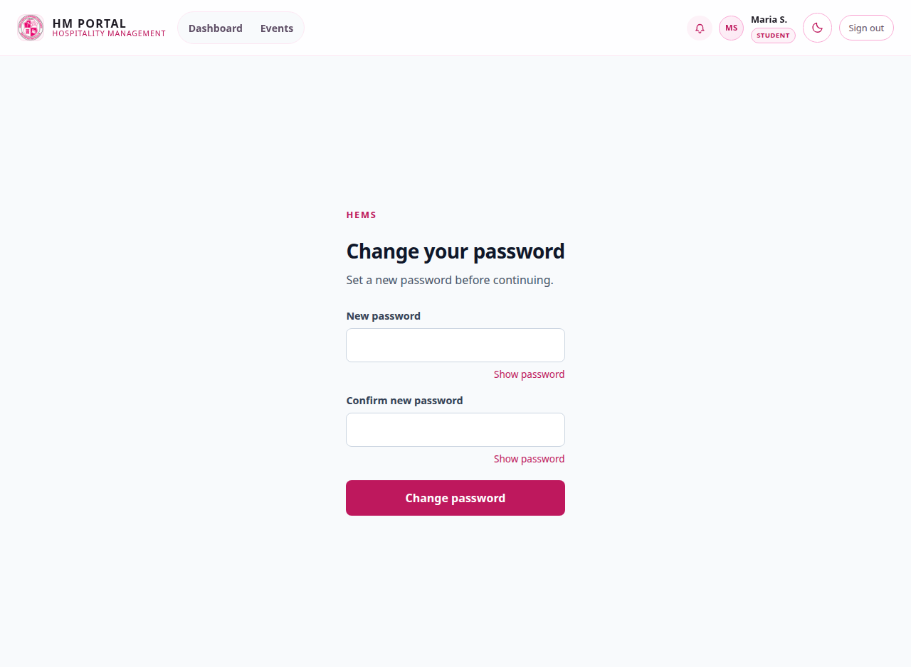
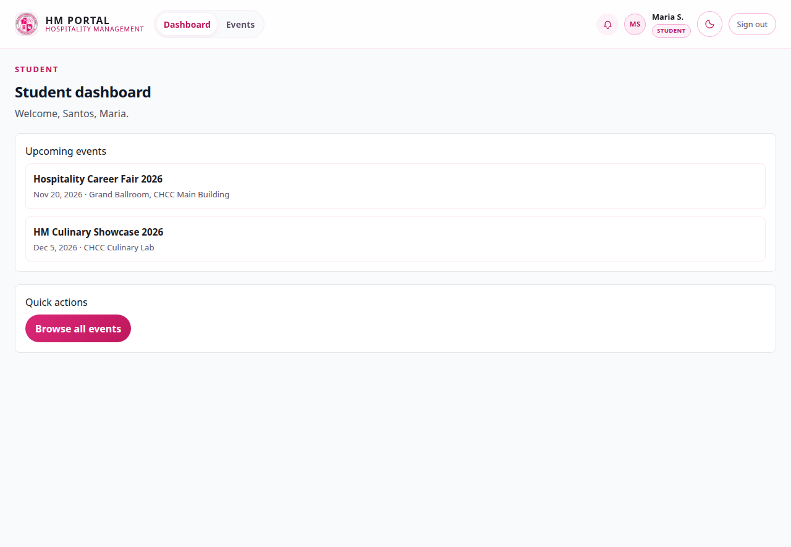
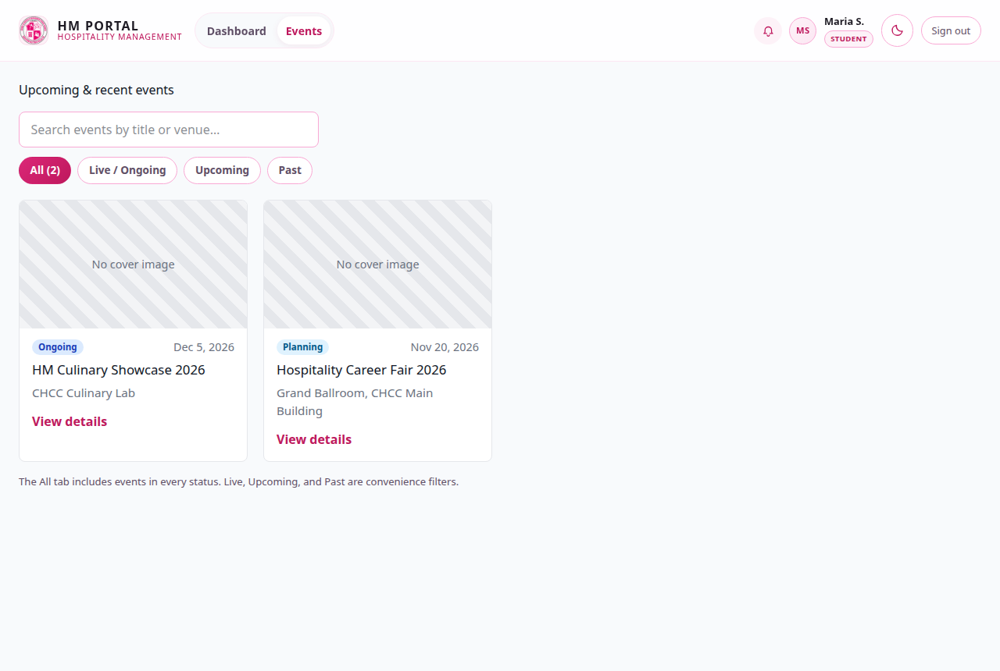
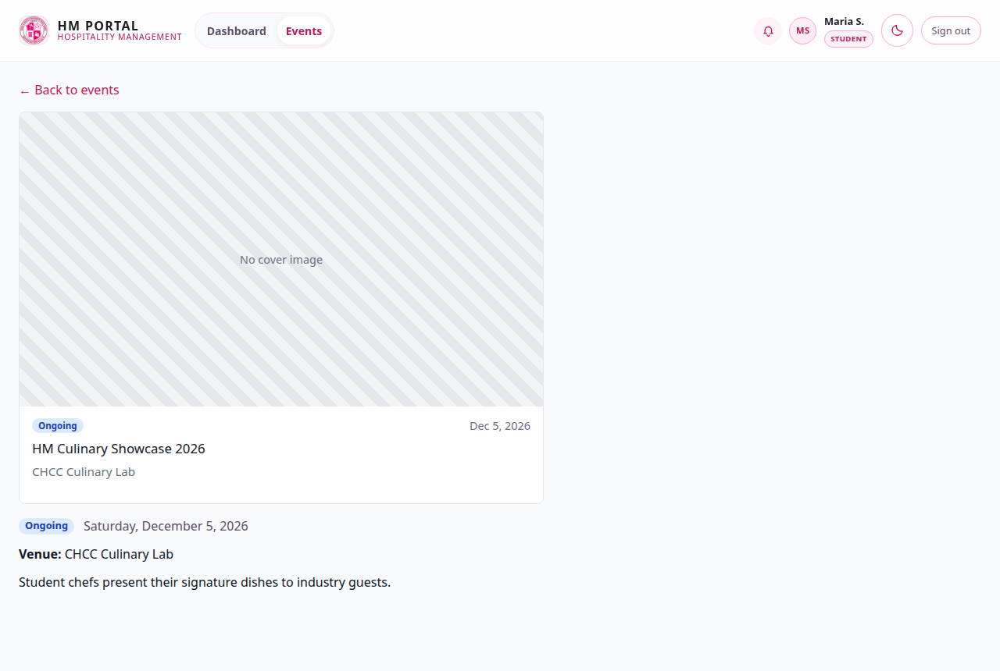
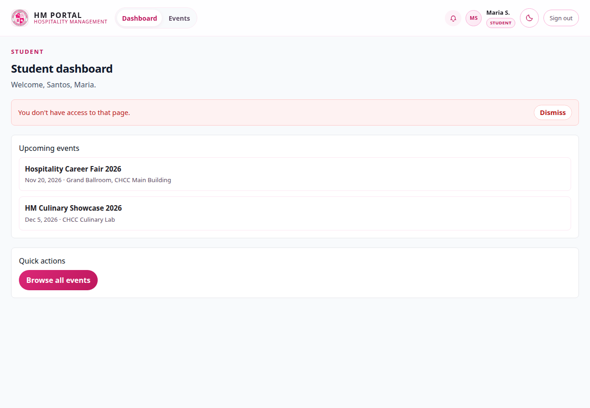

# HM Portal — Student Manual

The HM Portal is where the School of Hospitality Management posts its events —
career fairs, showcases, briefings and activities. This manual shows you what you can do
as a student account.

Screenshots were taken from a working local installation.

---

## 1. Signing in

Open the portal, choose **Sign in**, and enter the campus email and password your school
gave you.

---

## 2. Your first sign-in: setting your password

The first time you sign in you must set your own password before you can continue.

1. Type a new password in **New password**.
2. Type the same password in **Confirm new password**.
3. Click **Change password**.

Choose something you will remember — you will use this from now on. **Show password**
lets you check what you typed.

---

## 3. Your dashboard

The student dashboard shows:

- **Upcoming events** — what is coming up, with the date and venue of each event.
- **Quick actions** — **Browse all events** takes you to the full list.

The top bar has the notification bell, your initials, a light/dark mode toggle and
**Sign out**. Students see two tabs: **Dashboard** and **Events**.

---

## 4. Browsing events

Click **Events** to see everything that is happening.

- **Search** by event title or venue.
- **All** shows every event; **Live / Ongoing**, **Upcoming** and **Past** are quick filters.
- Each card shows the cover image, status, date, title and venue.

Cancelled events do not appear here.

---

## 5. Event details

Click **View details** on any event.

The event page shows everything about the event: its status, the full date, venue,
campus location, description and cover image.

---

## 6. What students cannot do

Students view events — they do not manage them. Specifically:

- There is no **New event** button for students.
- Students cannot edit events or change an event's status.
- The staff pages (**Reports**, **Users**, **Audit**) and the event management pages are
  not available.

If you try to open one of those pages you will be returned to your dashboard with
**"You don't have access to that page."**

If you think you should be able to manage events — for example as a student officer
helping with a school activity — ask your department head or an Admin to give your
account the right role.

---

## 7. Good to know

- **Events appear as soon as staff create them** — there is no waiting period.
- **A cancelled event disappears** from the list until staff resume it.
- **The notification bell** lists notifications for your account.
- **Dark mode** is toggled in the top bar and remembered on your device.
- **Forgotten password?** Ask an Admin to reset your account.
